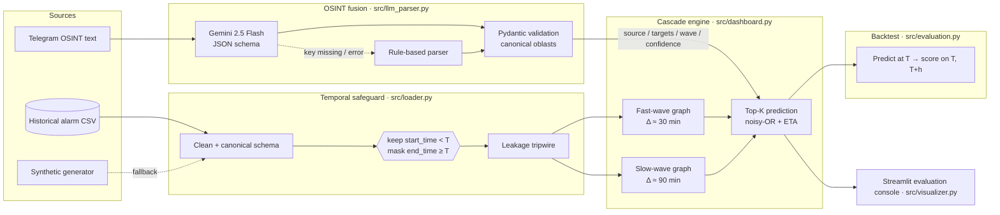

# Multimodal Spatiotemporal Air-Threat Cascade & LLM Intelligence Engine

**Time-series analysis of air-raid alerts in Ukraine with a strict temporal cutoff (no data leakage) and multimodal OSINT intelligence.**

Air-raid alarms do not happen in isolation. A ballistic launch from Belgorod lights up Kharkiv, Sumy and Poltava within minutes; a Shahed group leaving the Black Sea crawls across Odesa, Mykolaiv and Kirovohrad over hours. This engine models that propagation as **diffusion on a directed graph of oblasts**, learned only from alarms that started strictly before an observation instant **T**, and enriches the tabular alarm log with **Telegram OSINT reports normalised by Gemini** into the same vocabulary. A Streamlit console lets evaluators scrub **T** through history and watch every graph, metric and prediction recompute from the pre-**T** slice alone.

---

## Contents

1. [High-level concept](#high-level-concept)
2. [Architecture](#architecture)
3. [Velocity stratification: fast-wave vs slow-wave](#velocity-stratification-fast-wave-vs-slow-wave)
4. [Spatiotemporal graph diffusion](#spatiotemporal-graph-diffusion)
5. [Strict temporal safeguard (no data leakage)](#strict-temporal-safeguard-no-data-leakage)
6. [Multimodal OSINT fusion with Gemini](#multimodal-osint-fusion-with-gemini)
7. [Evaluation: leakage-safe backtest](#evaluation-leakage-safe-backtest)
8. [Quickstart](#quickstart)
9. [Running the dashboard](#running-the-dashboard)
10. [Running the tests](#running-the-tests)
11. [Configuration](#configuration)
12. [Repository layout](#repository-layout)
13. [Audit summary](#audit-summary)
14. [Limitations and honest caveats](#limitations-and-honest-caveats)

---

## High-level concept

| Question | Answer in this project |
|---|---|
| What is being modelled? | How an air-raid alarm in one oblast raises the probability, and sets the timing, of alarms in other oblasts. |
| What is the unit of analysis? | A directed edge **A → B** between oblasts, carrying the empirical probability that B alarms within a wave-specific window after A, and the median lag in minutes. |
| What makes it time-series safe? | Every quantity at cutoff **T** is a function of alarms with `start_time < T`; end times that were still in the future at **T** are masked. Verified by invariance tests, not just by inspection. |
| What makes it multimodal? | Free-text monitoring reports are parsed by Gemini (schema-constrained JSON, Pydantic-validated) into threat type, source and target oblasts, and injected as triggers at **T**. |
| What happens offline? | Everything still runs: a synthetic alarm generator replaces a missing CSV, a rule-based parser replaces Gemini, and a prior adjacency topology replaces an empty graph. Every fallback is labelled in the UI. |

---

## Architecture



| Module | Responsibility |
|---|---|
| `src/loader.py` | CSV ingestion, cleaning, canonical schema, synthetic generator, **temporal cutoff** and leakage tripwire. No project imports. |
| `src/config.py` | Crash-proof settings from `.env`; a missing `GEMINI_API_KEY` means offline mode, never an exception. |
| `src/llm_parser.py` | Gemini OSINT parser with schema-constrained JSON, Pydantic validation, rule-based fallback, synthetic demo scenarios and a circuit breaker. |
| `src/visualizer.py` | Map-aware rendering: oblast centroids, optional GeoJSON boundaries, schematic Ukraine outline, high-contrast layered graph figures. |
| `src/dashboard.py` | Fast/slow propagation graphs, cascade predictor, wave map, simulator with OSINT injection, methodology page, tactical UI. |
| `src/evaluation.py` | Leakage-safe backtest: precision/recall at K and ETA error against the post-**T** future, with a baseline. |
| `tests/` | 133 tests: unit tests per module, headless end-to-end runs of the page, and future-perturbation invariance tests. |

---

## Velocity stratification: fast-wave vs slow-wave

Alarm cascades have two very different kinematics, so the engine learns **two graphs** rather than blending them.

| | Fast-wave | Slow-wave |
|---|---|---|
| Threat types | Ballistic and cruise missiles, strategic and tactical aviation, guided bombs, artillery | Shahed-type strike UAVs, reconnaissance UAVs |
| Dynamics | Near-simultaneous multi-oblast activation within minutes | Progressive diffusion over 1–6 h as the group crosses oblasts |
| Edge window Δ | 30 min (sidebar-tunable) | 90 min (sidebar-tunable) |
| Signature | Short alarms, few hops, radial from the launch axis | Long alarms, multi-hop chains, strong night-time pattern |
| Prediction consequence | A trigger 20 min old has usually finished propagating | A trigger 20 min old is still mid-cascade |

Each threat label is normalised once, in `src/loader.py`, into a canonical taxonomy (`ballistic_missile`, `cruise_missile`, `aviation`, `guided_bomb`, `artillery`, `uav_shahed`, `uav_recon`) with a derived `wave_class`. The same taxonomy objects are imported by the OSINT parser, so text and tabular inputs can never drift apart.

---

## Spatiotemporal graph diffusion

Oblasts are nodes. For a wave class with window Δ, a directed edge **A → B** is recorded each time an alarm in B begins within Δ after an alarm of the same threat type in A.

- **Conditional spread probability** — the share of A's alarms followed by B inside the window:

  `P(B | A, Δ) = N_{A→B}(Δ) / N_A`

- **Transition speed** — the median lag between onsets, in minutes (mean and count are stored too):

  `τ_AB = median(t_B^start − t_A^start)`

Given triggers active at **T** (region *r*, elapsed *e_r* minutes, optional confidence weight *w_r*), each successor *s* receives a recency-discounted contribution; several triggers combine with a noisy-OR; the arrival estimate is the remaining lag:

```
p_{r→s} = w_r · P(s | r) · exp(−max(0, e_r − τ_rs) / λ)
P(s)    = 1 − ∏_r (1 − p_{r→s})
ETA_s   = max(0, τ_rs − e_r)
```

Two-hop paths multiply probabilities and add lags. λ (influence decay), the propagation depth and both windows are sidebar parameters. Node layout uses real oblast centroids, so the graph reads as a map; node size is alarm frequency before **T**. When a layer has no observed edges before **T**, a **prior adjacency topology** with distance-derived lags keeps the model explorable, drawn dashed and labelled as such.

---

## Strict temporal safeguard (no data leakage)

Evaluation at cutoff **T** only ever sees the dataset restricted to alarms that **started strictly before T**:

```
D_T = { x ∈ D : t_x^start < T }
t_x^end ← NaT   if t_x^end ≥ T          (the alarm is still running at T)
assert max_{x ∈ D_T} t_x^start < T       (tripwire: TemporalLeakageError)
```

How the guarantee is enforced:

- **Applied in the loader, before anything else.** `AirThreatLoader.apply_temporal_cutoff` and `load_and_filter_alarms` are the only ways data enters the engine. Graphs, activity, velocity, predictions and the backtest all consume their output.
- **Strict inequality.** A row starting exactly at **T** is future and is dropped. The boundary test asserts it.
- **End-time masking.** An alarm running at **T** has an unknown end; its end and duration are masked so nothing post-**T** can leak through durations or "active" status.
- **Tripwire.** `verify_no_leakage` runs after every filter and raises if any surviving row violates the inequality.
- **UTC everywhere.** All timestamps are normalised to UTC at nanosecond resolution; naive cutoffs are treated as UTC.
- **The full history is read separately only for UI metadata** (widget defaults, the data-range caption, filter options, the what-if region list) and for audit counters (rows withheld, ends masked). Nothing analytical is derived from it. The dashboard's status strip shows **T**, the latest visible start and the margin so this can be checked live.

How the guarantee is **verified** (`tests/test_leakage.py`):

- The loader's slice is compared field-by-field with an independent construction of "the world as of **T**".
- Every analytic output (active alarms, both wave graphs, the mixed graph, Top-K predictions, node activity, velocity, hourly onsets, daily counts) is computed twice: once on the real history and once after **everything at or after T is rewritten** (regions and threats shuffled, onsets moved, ends of running alarms changed, extra future rows appended). The outputs must be bit-identical. A control test confirms the same perturbation *does* change an unsafe pipeline.
- The same invariance holds through the CSV path.
- A cutoff after the last alarm makes the whole history visible with nothing masked, so the latest period is fully usable.

---

## Multimodal OSINT fusion with Gemini

Monitoring channels post terse, slang-heavy updates such as `⚠️ Сумщина: 6 мопедів курсом на Полтавщину, швидкість ~150 км/год`. The engine normalises them into the alarm log's vocabulary so text can drive the same cascade model:

1. **Gemini 2.5 Flash** through the official `google-genai` SDK, temperature 0, response forced to JSON against a schema: `threat_type`, `source_region`, `target_regions`, `confidence_score`, `raw_summary`, heading and count. The system prompt encodes the slang taxonomy and the oblast list.
2. **Pydantic validation** (`ParsedThreat`) canonicalises slang threat labels through the loader taxonomy, derives `wave_class`, maps Ukrainian, Russian and English region spellings to oblasts, keeps known external launch areas (Belgorod, Black Sea, Crimea, …) as sources only, clamps confidence, trims summaries and records unmapped mentions for audit.
3. **Graceful degradation.** Missing or invalid key, SDK absent, timeouts, rate limits or malformed JSON fall back to a rule-based parser that understands the same slang; six canned scenarios cover the demo messages, and are only used when the rule parser agrees the message says nothing more. A circuit breaker stops retrying after repeated failures. `parse()` never raises.
4. **Fusion.** In the simulator tab, pressing **⚡ Parse OSINT & Run Cascade Simulation** parses the pasted text, shows the structured record, and injects the parsed source and target oblasts as triggers **active at T** (elapsed 0, weighted by confidence) on the wave layer matching the parsed threat. Top-K targets, ETAs, the propagation view and the arrival timeline recompute immediately. The record is shown with badges and as expandable JSON so the fusion can be inspected.

Synchronisation assumption: a pasted report is treated as contemporaneous with **T**. The parser's own `parsed_at` stamp is metadata and is not used by any computation.

---

## Evaluation: leakage-safe backtest

`src/evaluation.py` turns the manual "scrub T and look" workflow into a metric. For each cutoff it builds the pre-**T** slice through the loader, predicts the Top-K next regions from the alarms active at **T**, and **only then** opens the window `[T, T + horizon)` of the full history for labels. The future is read in exactly one function, and the harness asserts the model's input ends before **T**. A naive baseline (the K most active regions in the last 24 h) is scored on the same labels.

```bash
python -m src.evaluation --records 3000 --seed 42 --cutoffs 12 --top-k 8
```

Synthetic history, 12 cutoffs, K = 8, 180-minute horizon:

| Metric | Graph model | Activity baseline |
|---|---|---|
| Precision at K | **0.25** | 0.16 |
| Recall at K | **0.54** | 0.39 |
| Mean absolute ETA error | 65 min | n/a |

These numbers describe the synthetic generator, not real conflict dynamics; their purpose is to show that the pipeline measures itself without peeking. Point `--csv` at a real export to evaluate on observed data.

---

## Quickstart

Requirements: Python 3.10+ (developed on 3.14), `pip`.

```bash
pip install -r requirements.txt
pip install google-genai pydantic      # OSINT parser; the app runs without them installed
cp .env.example .env                   # optional: add GEMINI_API_KEY to enable Gemini
python run_dashboard.py
```

No CSV and no API key are needed for a first run: the dashboard opens on synthetic data in offline OSINT mode and says so in a banner.

To use real alarm logs, place a CSV at `data/alarms.csv` (or set `ALARMS_CSV_PATH`). Common export headers are auto-detected (`region`/`region_title`/`oblast`, `start`/`started_at`/`start_time`, `end`/`clean_end`/`end_time`, `threat`/`alert_type`); timestamps are parsed in UTC.

To draw real oblast boundaries instead of the schematic outline, drop an administrative-boundary GeoJSON at `data/geo/ukraine_oblasts.geojson` (or set `UKRAINE_GEOJSON_PATH`). `geopandas` is used if installed; otherwise the file is parsed with the standard library.

---

## Running the dashboard

```bash
python run_dashboard.py                 # http://localhost:8501
python run_dashboard.py --server.port 8600
streamlit run src/dashboard.py          # equivalent
```

What you get:

- **Sidebar** — data source (CSV or synthetic), the temporal cutoff **T** as date and time with ±6 h / ±1 d nudges and a midpoint reset, wave-class and threat-type filters, and the cascade model parameters.
- **System indicators** — alarms before **T** with the withheld count, active alarms, cascade velocity with a 24 h sparkline, fast-wave share, data source and OSINT engine. Always visible, including for an empty slice.
- **Overview & metrics** — alarm onsets per day, threat mix, hour-of-day profile, the latest alarms before **T**, CSV export of the visible slice.
- **Wave map & spatiotemporal graph** — fast and slow layers over the Ukraine map, nodes sized by activity before **T**, edges labelled with probability and lag, a trigger selector with Top-K targets and arrival tags, layer summary and corridor tables. Renders on the prior topology when **T** has no data.
- **Cascade simulator** — OSINT input with the parse button, trigger source (observed alarms, what-if regions, OSINT record), trigger table, Top-K predictions with ETAs, the propagation view and an arrival timeline.
- **Methodology & architecture** — the write-up above with live audit numbers for the current **T**.

---

## Running the tests

```bash
python -m unittest discover -v tests
```

| Module | Tests | What it covers |
|---|---|---|
| `test_loader` | 29 | Cleaning, aliases, synthetic generator, strict cutoff semantics, end-time masking, tripwire, timezone handling |
| `test_config` | 15 | `.env` parsing, precedence, safe fallbacks for bad values, key masking |
| `test_llm_parser` | 30 | Region canonicalisation, Pydantic validation, rule-based parsing in three languages, scenarios, every Gemini failure path with a scripted client |
| `test_visualizer` | 11 | Centroids, schematic outline, GeoJSON loading and fallback, figure rendering with halos and map aspect |
| `test_leakage` | 6 | Independent reconstruction of the **T**-slice, future-perturbation invariance, CSV path, boundary semantics |
| `test_evaluation` | 7 | Ground-truth windowing, score consistency, prediction invariance to the future, model vs baseline |
| `test_dashboard` | 35 | Analytics functions plus headless end-to-end runs of the page: fallbacks, empty states, OSINT button flow, wave-map controls |

No network access is made by any test. Streamlit's `AppTest` drives the page in-process.

---

## Configuration

Copy `.env.example` to `.env`. Every variable has a safe default in `src/config.py`.

| Variable | Default | Purpose |
|---|---|---|
| `GEMINI_API_KEY` | empty | Enables Gemini parsing; empty means offline rule-based mode |
| `GEMINI_MODEL` | `gemini-2.5-flash` | Model for OSINT normalisation |
| `LLM_ENABLED` | `true` | Hard switch to disable LLM calls even with a key |
| `ALARMS_CSV_PATH` | `data/alarms.csv` | Historical alarm log |
| `SYNTHETIC_FALLBACK` | `true` | Use the generator when the CSV is missing |
| `SYNTHETIC_RECORDS` / `SYNTHETIC_SEED` / `SYNTHETIC_START_DATE` | `2000` / `42` / `2026-01-01` | Generator parameters |
| `DEFAULT_CUTOFF_TIMEZONE` | `UTC` | IANA zone for interpreting naive cutoffs |
| `ACTIVE_WINDOW_HOURS` | `8` | Open-ended alarms older than this are feed gaps, not active |
| `CASCADE_MAX_LAG_MIN` / `CASCADE_DECAY_MIN` | `90` / `60` | Cascade model defaults |
| `UKRAINE_GEOJSON_PATH` | unset | Optional boundary file for the map underlay |

Secrets never reach logs: settings expose a masked key only.

---

## Repository layout

```
.
├── run_dashboard.py          # launcher → streamlit run src/dashboard.py
├── requirements.txt
├── .env.example              # documented settings template
├── .streamlit/config.toml    # tactical dark theme, magic disabled
├── src/
│   ├── loader.py             # ingestion, synthetic data, temporal safeguard
│   ├── config.py             # crash-proof settings
│   ├── llm_parser.py         # Gemini OSINT parser + rule-based fallback
│   ├── visualizer.py         # map-aware graph rendering
│   ├── dashboard.py          # cascade engine + Streamlit console
│   └── evaluation.py         # leakage-safe backtest harness
└── tests/                    # 133 tests, no network
```

---

## Audit summary

A self-audit against the hackathon brief was performed before this README was written. Findings:

- **Temporal safeguard** — every loader comparison is a strict `<` on starts and `>=` on ends; the only wall-clock call in the codebase is the parser's `parsed_at` stamp, which no computation reads; the uncut history is used in the dashboard solely for widget defaults, range captions, filter options, the what-if region list and audit counters. Future-perturbation invariance tests pass through both the in-memory and CSV paths.
- **Tests and coverage** — 133 tests pass. Statement coverage measured with the standard-library tracer: loader 90.5%, config 94.3%, llm_parser 92.6%, visualizer 90.9%; all 50 functions of the dashboard module are exercised by its headless tests.
- **Imports** — the dependency graph is acyclic (`loader` and `config` import nothing from the project; `llm_parser` and `visualizer` depend on them; `dashboard` and `evaluation` sit on top). Each module imports cleanly in a fresh interpreter.
- **Fallbacks** — verified end to end: no key + no CSV → synthetic data with banner; CSV requested but missing → automatic fallback with banner; corrupt CSV → explicit error, never silently replaced; valid CSV → used without fallback; invalid Gemini key → one API call, then permanent offline rule-based parsing; network timeouts → retry, circuit breaker, answers continue.
- **Cold start** — the real entry point starts headless with the API key and CSV absent, answers its health endpoint and serves the page with no errors logged.

---

## Limitations and honest caveats

- **Synthetic data is synthetic.** The generator reproduces spatial skew, burst structure, wave kinematics and the night-time UAV pattern, not real geopolitics. All numbers shown in synthetic mode evaluate pipeline mechanics only, and the UI says so.
- **Correlation, not causation.** Co-occurrence edges capture statistical propagation, not command intent or air-defence decisions.
- **Prior topology** uses nominal speeds (900 km/h fast, 150 km/h slow) and fixed probabilities; it is a labelled placeholder for empty slices, never mixed into observed layers.
- **Schematic map** is a coarse hand-drawn outline until a boundary GeoJSON is provided.
- **OSINT timing** assumes a pasted report is contemporaneous with **T**; messages carry no trusted timestamp.
- **Offline OSINT confidence** is heuristic and capped at 0.85; Gemini's confidence is model-reported, not calibrated.
